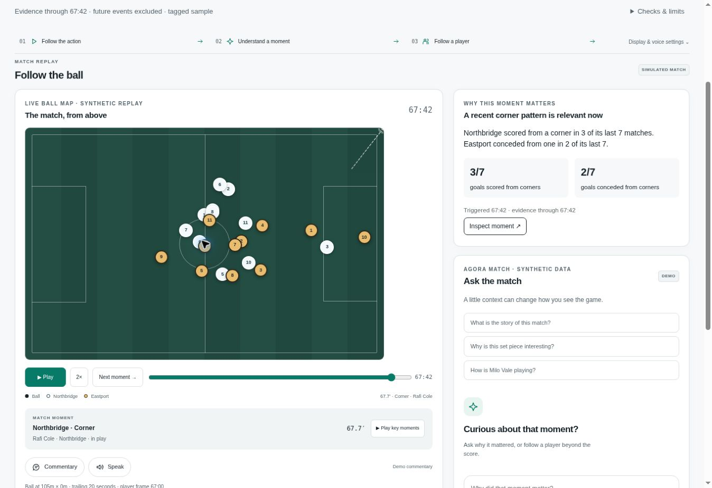

# Agora Match

## The story behind the score

A football intelligence prototype for **fans, analysts, and coaches**. Follow a synthetic match, ask why a moment matters, and inspect the evidence behind the answer.

### Why Agora? · Αγορά

In ancient Greece, the agora was a public gathering place where people exchanged ideas and debated different viewpoints. Agora Match carries that spirit into football: a shared game, shared evidence, and different ways to understand what happens on the pitch.

**Football belongs to everyone.** Follow the emotion as a fan, investigate as an analyst, or consider the decisions as a coach. These are perspectives anyone can try; change between them whenever you want.

**One match. Many perspectives.**

[See the welcome screen](docs/images/agora-welcome.jpg). The app includes a keyboard-accessible “Why Agora? / Αγορά” explanation and a “Change perspective” control throughout the experience.

**[▶ Try the app](https://agoramatch.russettitan64.chatgpt.site/)** · **[Watch the 97-second demo](https://agoramatch.russettitan64.chatgpt.site/showcase.html)** · [Submission materials](SUBMISSION.md)



### Three roles. One shared match.

| Role | Start here | What you can do |
|---|---|---|
| Fan | Matchday | Follow the ball, hear a recap, ask why a moment matters, and follow a player |
| Analyst | Analysis desk | Find tagged matchup cases, inspect prior positions, compare history, and export a brief |
| Coach | Review board | Prioritize spacing and output cues, inspect a player, and prepare a review conversation |

[Analyst screenshot](docs/images/agora-analyst-workspace.jpg) · [Coach screenshot](docs/images/agora-coach-workspace.jpg)

## Try this in two minutes

1. Choose **Fan**, then **Northbridge vs Eastport**.
2. On the replay, go to the corner at **67:42**. Its context card compares both teams' seven-match corner record.
3. Ask **“Why is this set piece interesting?”** Open the supporting facts and its source event.
4. Switch to **Analyst** for the fullback-versus-winger case finder. Rewind to **20:00**: eight cases become one and the score becomes 0–0.
5. Open a player for role KPIs, a heatmap, a rating trace, and history. Switch to **Coach** for qualified review cues.
6. In the analyst desk, preview a broadcast card and download its timed evidence JSON.

The second fictional fixture, **Harbor City vs Redvale**, demonstrates a free-kick and central-build-up scenario.

## Where AI adds value

An optional **Microsoft Foundry** workflow explains a bounded evidence bundle through three roles: **match analyst → audience narrator → evidence reviewer**. Application code supplies the statistics, inserts canonical fact values, checks references, and provides fallback wording. The LLM's job is to make the evidence understandable for the selected audience.

**Execution status:** the one-click public demo uses deterministic answers and requires no account or key. Foundry integration, Azure Identity, Azure Container Apps Bicep, monitoring, and deployment/evaluation scripts are included in the source. Live Foundry evaluation and Azure deployment remain unverified. The project does not claim live-model accuracy or measured multi-agent superiority.

[Verify real Foundry calls](docs/foundry-verification.md) using an existing deployment or the manual GitHub verification workflow.

## What makes the evidence inspectable

- **One match clock:** chat, stats, recaps, heatmaps, ratings, and exports use the selected replay cutoff. Future events disappear when you rewind.
- **Visible provenance:** sample sizes, source IDs, limitations, and replay links travel with a finding.
- **Qualified physical cues:** sparse high-speed readings are samples, not measured sprint totals or a fatigue diagnosis. A paired-player gap does not prove a missed assignment.
- **Broadcast handoff:** a timed JSON card carries source facts, audience copy, match timing, and expiry.

All clubs, players, history, coordinates, events, and telemetry are **fictional synthetic data**. No Premier League match data or footage is included. Player positions are sampled once per minute; the ball path is illustrative event-constrained interpolation. The event feed is a sparse tagged sample, not a full provider feed.

## Run it locally

### Static demo — Python 3.12+, no API keys

```bash
git clone https://github.com/rafaelnikitas/agora-match.git
cd agora-match
python -m agora_match.build_site
python -m http.server 8080 --directory dist
```

Open **http://localhost:8080**. The build regenerates all synthetic JSON from the included source.

### Python API and optional Foundry

```bash
python3.12 -m venv .venv
source .venv/bin/activate
python -m pip install --require-hashes -r requirements.txt
python -m agora_match.build_static
python -m agora_match.server
```

On Windows, activate with `.venv\Scripts\activate`. See [Azure setup](docs/azure-readiness.md) for identity, model deployment variables, and infrastructure. Never put credentials in client code. The default server also works without AI credentials.

### Container

```bash
docker build -t agora-match .
docker run --rm -p 8080:8080 agora-match
```

The image generates synthetic data during its build. Cloud provisioning is optional and may incur Azure charges.

## Verify

```bash
python -m unittest discover -s tests -q
python -m agora_match.build_site
node tests/browser_evidence.cjs
python scripts/verify_intelligence.py
```

Local release results: **65 unit/API tests**, **82 synthetic acceptance examples**, and **73 browser-fallback checks** passed. These checks cover deterministic behavior and mocked model failure modes; they are not a live LLM accuracy score. [Accuracy and evaluation](docs/accuracy-and-evaluation.md).

## Repository map

| Path | Purpose |
|---|---|
| `agora_match/` | Synthetic generators, evidence retrieval, calculations, chat, Foundry adapter, API, and static builder |
| `static/` | Role-specific browser UI, pitch replay, charts, chat, and demo viewer |
| `tests/` | Regression checks for evidence, replay time, UI fallback contracts, and model failure behavior |
| `infra/` | Azure Container Apps, model resources, managed identity, monitoring, and parameter examples |
| `scripts/` | Deployment, preflight, smoke checks, and single-model versus three-role evaluation |
| `docs/` | Data contract, Azure setup, evaluation details, role design, screenshots, and demo credits |
| `SUBMISSION.md` | Pitch, honest technology status, business path, and remaining entry steps |

Generated `static/data/` and `dist/` are build outputs. Recreate them with `python -m agora_match.build_site`.

## Read more

[Dataset requirements](docs/dataset-requirements.md) · [Role design](docs/role-experiences.md) · [Azure readiness](docs/azure-readiness.md) · [Evaluation](docs/accuracy-and-evaluation.md) · [Detailed engineering overview](docs/engineering-overview.md)

The source is public for hackathon review. No additional open-source license has been selected; dependencies retain their own licenses. [Demo asset credits](docs/demo-assets.md).
