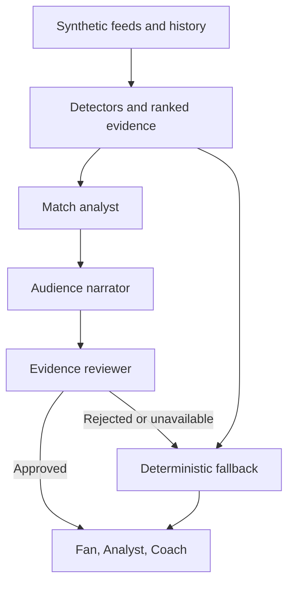

# Agora Match

> **See the match behind the score.** Agora Match turns a football event feed into explainable stories for fans, analysts, and coaches.

<p align="center">
  <a href="https://playerlens-match-intelligence.russettitan64.chatgpt.site/"><strong>▶ Open the live Agora Match demo</strong></a>
</p>


[Analyst workspace](images/agora-analyst-workspace.jpg) · [Coach workspace](images/agora-coach-workspace.jpg)

## What you can try

1. Choose one of two fictional matches and switch between Fan, Analyst, and Coach views.
2. Play the synthetic event feed to watch the clock, score, event, and ball map move together.
3. Ask Agora a question, then follow up naturally. Answers can pair live events with synthetic team and player history and show the evidence and caveats.
4. Open a ranked insight and preview or download a timed JSON broadcast card.
5. Follow a player to inspect movement, role-specific KPIs, sample rating, workload, and tagged matchups.

## Three workspaces, three jobs

| Workspace | Starts with | Your path | Assistant response |
|---|---|---|---|
| **Fan** | Live pitch, commentary, and a player spotlight | Watch → understand a moment → follow a player | A clear takeaway, with sources available on demand |
| **Analyst** | Investigation presets, visual cases, and coverage metrics | Ask → inspect events and shapes → export an evidence brief | Finding, sample, source IDs, and limits |
| **Coach** | Team-specific priority queue and player review | Scan → confirm context → prepare a review conversation | Observed cue, review question, and uncertainty |

The layouts, landing screens, navigation, prompts, player summaries, and evidence depth change by role. Chat sessions stay separate for each match and role. Light/dark mode and plain-language settings are independent of the role. [Experience design and acceptance checks](role-experiences.md).

## Why the LLM matters

Agora keeps football calculations in deterministic, testable code. A retrieval layer selects bounded event and historical evidence; Microsoft Foundry can then explain that verified evidence in the chosen audience's voice. Responses keep evidence references and caveats, and fall back to deterministic wording if the model is unavailable. This keeps the LLM focused on turning verified match intelligence into a useful explanation instead of inventing statistics.

**Demo status:** the one-click hosted site is a static, key-free synthetic-data demo. It demonstrates the evidence-backed chat and narrative flow using deterministic responses. The server-backed build can use Foundry models when deployment settings are configured; the hosted static demo does not claim a live model connection.

**Azure readiness:** the same interface now has a production ASGI API, reproducible Bicep infrastructure, managed identity, three checked AI roles, Azure Monitor instrumentation, and deployment acceptance gates. [Azure setup and verification](azure-readiness.md). Infrastructure compilation and local tests do not establish a successful live Azure deployment.

## Accuracy and review improvements

The replay now drives a shared evidence cutoff for chat, KPIs, heatmaps, ratings, coaching cues, recaps, and exports. Rewinding removes later evidence. Source buttons open a corresponding replay moment; “Why this moment matters” combines a trigger, facts and timing. A visible checks drawer distinguishes synthetic acceptance results from unmeasured live LLM quality.

Box-touch geometry and dribble outcomes are corrected. Sparse speed readings are labeled as high-speed samples, and incomplete physical/spacing windows are withheld. Player history has one canonical ledger, with comparable rates and denominators where available. Free-text chat explicitly declines unsupported players, metrics and predictions.

The narrator now selects fact IDs and writes a qualitative explanation; application code inserts the exact fact labels and values. Three-role mode additionally reviews the assembled answer. English/Greek AI explanation settings preserve source labels; deterministic Greek requests use an explicit English fallback.

[Accuracy checks, live evaluation, and limitations](accuracy-and-evaluation.md). The release has 64 passing unit/API tests, 82 passing synthetic acceptance examples, and 73 passing browser-fallback checks. These figures describe local checks, not measured live-model accuracy.

## Project at a glance

| Area | What Agora Match demonstrates |
|---|---|
| Synthetic match intelligence | Reproducible event, tracking, wearable, player-history, and team-history feeds |
| Explainable stories | Ranked insights cite their source metrics or event IDs and include limits |
| Audience personalization | Fan, Analyst, and Coach presentations over shared evidence |
| Broadcast path | Timed insight preview and downloadable, machine-readable JSON |
| Player perspective | Heatmap, role KPIs, historical comparison, rating trace, and tagged one-v-one cases |
| Microsoft AI | Optional Foundry model handoff: match analyst → role narrator → evidence reviewer |

All clubs, players, match events, histories, coordinates, and sensor values are invented. There is no Premier League match data or footage in this project.

Agora Match is a synthetic-data football match companion. It turns fictional event, tracking, and recent-match aggregates into ranked, evidence-linked stories for fans, match explorers, and studio users.

## What works in this MVP

- Two reproducible fictional matches with 22 players each: one features a corner and repeated wide attacks; the other a direct free kick and central build-up. A second-by-second ball replay synchronizes the pitch marker and match clock; player locations remain minute-sampled.
- Synthetic event-feed playback advances tagged events in match order and synchronizes the event card, scoreboard, clock, and ball replay. It replays pre-generated events; it is not a live data provider.
- Ranked insights can be previewed as audience-specific timed broadcast cards and downloaded as JSON with match timing, evidence records, and caveat metadata.
- Four small insight workers: recent set-piece history, current attack patterns, player running output, and defensive spacing.
- A coordinator ranks findings using explicit match relevance and evidence quality.
- Three distinct audience workspaces—Fan, Analyst, Coach—change the workflow, layout, explanation, and detail while keeping the same evidence. Studio-ready copy remains an output style within the analyst view.
- A role-first onboarding page routes Fan to matchday, Analyst to the analysis desk, and Coach to the review board. Each has a short, actionable workflow; the role can be changed at any time.
- Simple sun/moon controls switch between light and dark themes without changing the underlying match or evidence. Display settings also include text sizing, plain-language explanations, keyboard support, and browser text-to-speech; these are accessibility-minded prototype features, not a formal WCAG certification.
- Fan view adds an optional browser spoken recap with generic commentary styles. Analyst view shows seven-match team context, event-level insights, and downloads a Markdown evidence brief. Coach view adds a player-selected, ten-minute synthetic effort trend beside existing team review cues.
- Visitors can select a match, follow any of its 22 players, switch audience view, and share a deep link that preserves those selections.
- Four role-aware areas separate live match, player performance, insights and chat, and coach review. The live pitch is the visual anchor; play-by-play stays collapsed until opened. Scrub the ball path, choose 1×/2×/4× playback, or jump straight to the next tagged moment.
- Player screens show a synthetic movement heatmap, match rankings, last-five and season-average comparisons, and role-specific KPIs (for example, striker penalty-area touches or centre-back aerial duels).
- Player screens include a transparent match-rating timeline (neutral 6.0 baseline, small capped event values) and a tagged one-v-one ledger with the opponent, outcome, minute, and denominator. The score is explicitly a demo model, not an official FIFA/EA rating.
- Coach review combines synthetic passing accuracy, peak speed against same-role peers, paired high-speed sample windows, tagged opponent matchups, tracking-derived changes in paired-player distance, and sampled wearable effort-zone trends. It does not claim to know real marking assignments or ball-receipt decision time.
- An automated live recap combines the score, current event, and top ranked insights, with evidence rows shown alongside it.
- A prompt-style match chat accepts questions about players, tactical sequences, recent set pieces, running output, matchups. Analyst chat can open a visual board of tagged winger-versus-fullback cases. Fan, Analyst, and Coach audiences receive different levels of detail over the same verified facts.
- The chat retrieves facts only from the selected synthetic game. The public static link returns deterministic evidence-based answers; a local/server build can optionally use Microsoft Foundry to rephrase that evidence while retaining fact citations and numeric-claim checks.
- An optional Foundry handoff with separate analyst, narrator, and reviewer model roles. Each sees only the supplied evidence; deterministic copy remains available without credentials or network access.
- Per-insight “Narrate with AI” action in the app, with a visible label indicating whether Foundry or deterministic fallback produced the copy.
- A FastAPI web service and JSON endpoints, with hash-locked dependencies, a non-root container, health probes, validated inputs, bounded model retries, circuit recovery, and per-replica request limits.
- A resumable synthetic-event SSE endpoint for future stream consumers. The existing UI keeps its familiar browser replay controls.

All teams, players, events, aggregates, and positions in this project are fabricated. Do not replace them with Premier League match data for the hackathon submission.

The rating, matchup, and coach views use deterministic calculations over explicitly synthetic event and tracking records. The LLM is not used to assign a rating, decide that a player lost a matchup, diagnose fatigue, or infer tactical intent. A paired-player distance increase is only a geometry cue, not proof of a lost coaching assignment. Calculations and confidence limits stay in application code.

## Online data sources and the LLM's role

For an ingestion prototype outside the hackathon's synthetic-data submission, the richest public starting point is a combination of:

- [StatsBomb Open Data](https://github.com/statsbomb/open-data): event-level actions, match/competition metadata, lineups, and 360 freeze frames for selected matches. It does not provide full continuous tracking for every match.
- [Metrica Sports sample data](https://github.com/metrica-sports/sample-data): anonymized, synchronized event and player/ball tracking samples. It is excellent for building and validating heatmaps and movement features, but it is only a small set of sample games.
- [Wyscout public soccer match event dataset](https://figshare.com/collections/Soccer_match_event_dataset/4415000): broad historical event logs with player, time, position, and action outcome fields; check the dataset's current license and attribution conditions before redistribution or commercial use.

Commercial providers such as Hudl/StatsBomb and SkillCorner can offer more complete event, tracking, identity, and physical data, but access, redistribution, and price depend on the agreement. Public websites generally cannot supply reliable sprint-load, fatigue, xG/xA, and all-match player histories for arbitrary live fixtures. Those require explicit provider fields or models that are trained and validated on compatible data. Do not scrape consumer score sites as a substitute for a licensed feed.

The intended LLM workflow is tool orchestration, not free-form web scraping or arithmetic: (1) resolve a requested match/provider from an allowlisted catalog, (2) call that provider's documented connector with server-side credentials, (3) validate IDs, timestamps, coordinates, coverage, and license metadata, (4) normalize records into the app schema, (5) compute counts, xG/xA, rankings, movement density, and comparisons with deterministic code, and (6) let the model explain the verified outputs with citations to source records. The model must report missing fields as unavailable and never invent a value. The public hackathon demo uses only the synthetic fixture and does not fetch real matches.

## Run locally

```bash
python3.12 -m venv .venv
source .venv/bin/activate
python -m pip install --require-hashes -r requirements.txt
python -m playerlens.build_static
python -m playerlens.server
```

Open http://localhost:8080. Run tests with:

```bash
python -m unittest discover -s tests -v
```

Rebuild the static visitor demo data after changing the synthetic fixtures or insight rules:

```bash
python -m playerlens.build_static
```

Build the complete click-to-open static site into `dist/` with one command:

```bash
python -m playerlens.build_site
```

The generated `static/data/*.json` files and `dist/` are recreated by the build, so the hosted experience runs with no Python process, package install, account, or API key. The public static preview uses deterministic evidence-based copy. The Python server is needed for optional Microsoft Foundry narration. The public static preview intentionally does not embed a model key.

## What Microsoft Foundry does here

Microsoft Foundry is Microsoft's platform for deploying AI models and building agent-based apps. Agora uses Foundry model deployments for three distinct jobs after deterministic code has retrieved and checked the match evidence:

1. **Match analyst** reads the supplied evidence and drafts a cautious observation.
2. **Role narrator** explains it for a fan, analyst, or coach.
3. **Evidence reviewer** checks the answer against the same facts. If a model fails, invents a number, or rejects the draft, Agora returns its evidence-based fallback.

The jobs hand off a small shared evidence bundle; models do not query arbitrary websites, calculate KPIs, assign blame, or control the live replay. Set all three role deployment variables to activate the checked pipeline. They can share one deployment or use different models. If only `AZURE_FOUNDRY_DEPLOYMENT` is set, the app uses the single-model path. The public static demo stays key-free and uses deterministic copy.

This POC orchestrates Foundry model calls in the Python service. Foundry Agent Service and Microsoft Agent Framework workflows are a follow-on deployment option for managed agent hosting, traces, and evaluations; they are not required for the local demo.

## Connect Foundry Models

Create a model deployment in Microsoft Foundry, grant your signed-in identity the Cognitive Services OpenAI User role on the model resource, run `az login`, and set these environment variables before starting the app:

```bash
export AZURE_FOUNDRY_BASE_URL="https://<resource>.openai.azure.com/openai/v1/"
export AZURE_FOUNDRY_AUTH_MODE="default_credential"
export AZURE_FOUNDRY_READER_DEPLOYMENT="agora-chat"
export AZURE_FOUNDRY_WRITER_DEPLOYMENT="agora-chat"
export AZURE_FOUNDRY_REVIEWER_DEPLOYMENT="agora-chat"
# For the example reasoning model only:
export AZURE_FOUNDRY_REASONING_DEPLOYMENTS="agora-chat"
export AZURE_FOUNDRY_REASONING_EFFORT="low"
```

The Azure deployment uses managed identity with local key authentication disabled. API-key authentication remains an explicit compatibility option for an existing separately managed resource. Never commit keys. A partial three-role configuration is rejected; use `AZURE_FOUNDRY_DEPLOYMENT` alone for the single-model option. With no AI configuration, the app uses deterministic persona copy. A failed or rejected handoff also returns the evidence-based fallback.

The URL should end in `/openai/v1/`, for example `https://<resource>.openai.azure.com/openai/v1/`. The app posts to `/chat/completions` and sends the deployment name in `model`.

## Architecture



### Data contract

The detailed schema, required and optional fields, units, quality gates, feature dependencies, and synthetic-data rules are in [`docs/dataset-requirements.md`](dataset-requirements.md). The generated history and live-feed files are described there individually. Events, matchups, team history, player histories, tracking, and wearables in the POC are synthetic. Referee analysis is deferred and is not part of the current app experience. The LLM only sees a small retrieved evidence bundle; deterministic code supplies calculated stats and source IDs.

### Insight flow

Each deterministic worker receives the same immutable match state and returns a structured candidate containing a finding, trigger, evidence rows, relevance, and caveat. The coordinator ranks candidates by match relevance and evidence completeness. The optional Foundry model handoff receives only the selected evidence and audience; numeric claims are guarded in code, then an evidence reviewer can reject the assembled draft. The deterministic copy remains the fallback.

### Three views

- **Fan:** short, jargon-free explanation and why it matters now.
- **Analyst:** same finding plus metrics, comparison, event sequence, and caveats.
- **Coach:** tactical review cues, role context, and caveats. Studio-ready copy remains an output style within the coach/analyst views.

The match and player selectors are reflected in URL parameters (`match`, `view`, `player`), so visitors can share a link to a particular match and perspective.

## Production path

The included Bicep deploys one Azure Container Apps service for the existing UI and API, Foundry model deployments, a user-assigned identity, ACR, and Azure Monitor. Answers expose actual role execution, latency, and token usage; approved responses have a bounded short-lived cache. Limits and circuit state are in memory per replica. A future production feed can replace the synthetic replay adapter with Event Hubs and a shared state store. Those services are intentionally outside this POC. [Deployment, costs, verification, and remaining gates](azure-readiness.md).

## API

- `GET /api/games` returns the synthetic match selector list.
- `GET /api/state?game_id=<id>&view=fan|analyst|coach` returns the selected match, ranked insights, recap, active presentation, and Foundry mode (`demo`, `single-model`, or `three-role`).
- `GET /api/health` returns a simple health response.
- `GET /health/live` and `GET /health/ready` support platform probes. Readiness validates data and required AI configuration; it does not spend tokens checking the provider.
- `GET /api/capabilities` reports data mode, AI connection state, telemetry configuration, and the scope of limits.
- `GET /api/events/<game_id>?after=-1&speed=2` replays ordered synthetic events as SSE, with `Last-Event-ID` resume support. This is a replay adapter, not a real match feed.
- `POST /api/narrate` with `{"game_id":"...","insight_id":"...","view":"fan"}` requests optional Foundry phrasing. It falls back safely when Foundry is not configured.
- `POST /api/ask` with `{"game_id":"...","persona":"fan|analyst|coach","player_id":"N8","question":"..."}` returns an audience-adapted answer, cited synthetic facts, coverage caveat, and whether Foundry was used. Questions are limited to 1,000 characters; invalid IDs and personas are rejected.

## Demo pitch

Agora Match turns synthetic match events and tracking into a player-first companion. Scrub a second-by-second illustrative ball path, inspect player-level performance and team patterns, and open tagged matchup cases on a visual pitch. Every finding is linked to synthetic evidence; fans get plain language, analysts get metrics and caveats, and coaches get review cues. Foundry can rewrite verified evidence without calculating the football signal.

See [`docs/demo-script.md`](demo-script.md) for a sub-two-minute walkthrough.

See [`docs/winning-plan.md`](winning-plan.md) for the final submission checklist, business case, Foundry work plan, and rubric mapping.

## Evaluation checklist

- Unit tests assert each detector against the controlled synthetic fixture.
- Check the same insight/evidence IDs persist across all three views.
- Check every displayed number comes from the evidence object.
- Time the event analysis separately from optional model narration.
- Failure tests exercise timeout, malformed responses, identity/auth failures, numeric injection, reviewer rejection, rate limits, and circuit recovery.
- `scripts/smoke_azure.py --url <azure-url> --require-ai` requires fresh successful execution of all three model roles; deterministic fallback cannot pass.
- `scripts/evaluate.py` measures known evidence routing, real-model/fallback rate, and latency across both games and all roles. It does not certify semantic quality.

## Hackathon fit and current limits

- **Synthetic-data rule:** all matches, recent-form aggregates, event labels, player names, and tracking coordinates are invented and seeded. No Premier League match data is used.
- **Interpret and explain:** four specialized detectors return structured evidence, confidence-like relevance ordering, and caveats; the coordinator ranks them for the current moment.
- **Render and personalize:** the same match intelligence is shown in Fan, Analyst, and Coach modes, and visitors can follow any player and replay either match.
- **Narratives and recaps:** the live recap and prompt-style chat use current synthetic match state and ranked evidence. Microsoft Foundry can rewrite retrieved chat evidence for the selected audience in the server-backed version; deterministic answers remain available without credentials.
- **Demo readiness:** static match selection works from a click-to-open page; the server build adds Foundry narration, deployment infrastructure, telemetry, and acceptance scripts. A live Azure account run, externally executed container CI, a real data provider, and multilingual model evaluation are still pending.
- **Submission still needed:** public GitHub repository URL and public demo video under two minutes.

## Azure container

Build and run locally:

```bash
docker build -t playerlens .
docker run --rm -p 8080:8080 playerlens
```

For Azure, use the provided [deployment runbook](azure-readiness.md). It builds the image remotely in ACR, deploys its immutable digest, and verifies real three-role model execution. No model keys are placed in the image, repository, or browser.
