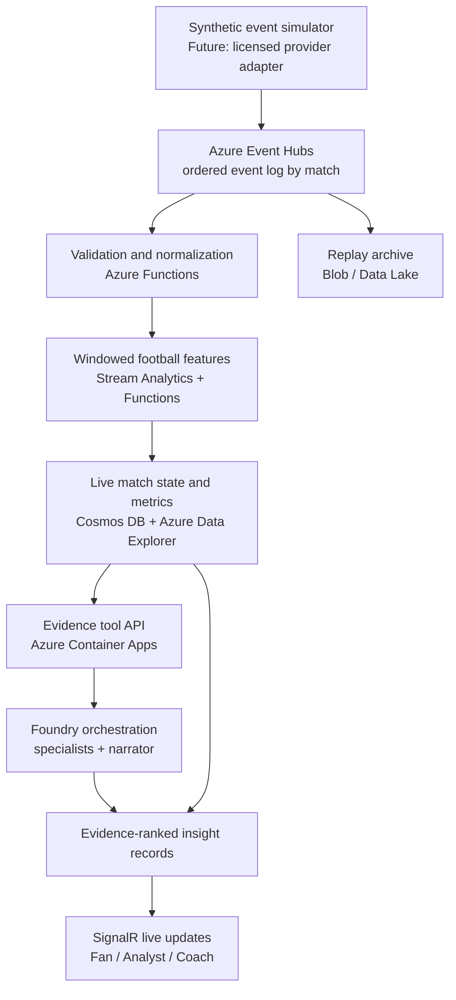

# Agora Match live match intelligence platform

## Purpose

Turn a live or replayed football event stream into four in-scope experiences: live play-by-play, team tactics, player perspective, and coaching review. Referee analysis is explicitly deferred. The hackathon build must use synthetic, football-realistic data throughout. A production provider feed is a future adapter; it is not required for the hackathon demo.

The key design rule is: **calculate football facts in deterministic services, then use LLMs to explain, compare, and personalize those verified facts.** Do not send every raw event to a model and ask it to keep score, calculate KPIs, infer fatigue, or invent tactical causes.

## Architecture



The hosted multi-service diagram is the target architecture, not a claim about the current public demo. The demo currently serves a static, deterministic synthetic match catalog. The Python server has an optional Microsoft Foundry narration path, but the public static app does not call a hosted model.

| Layer | Recommended role | Microsoft/Azure implementation |
|---|---|---|
| Event source | Produce synthetic events and tracking for the hackathon; later swap in a licensed data-provider adapter. Include event time, sequence, match, team/player IDs, action, outcome, possession, coordinates, and coverage/source metadata. | Local generator first; provider connector later. Never put provider credentials in the browser. |
| Ingestion | Durable, replayable stream that decouples producers from processors and allows separate consumers for analytics, narratives, archive, and QA. | Azure Event Hubs. Use `match_id` as a partition key only when per-match order is necessary; partition affinity is a consistency/availability trade-off, so test the choice against failure behavior. Event Hubs supports independent consumer groups and ordered delivery within a partition. [Event Hubs overview](https://learn.microsoft.com/en-us/azure/event-hubs/event-hubs-about) and [availability/ordering guidance](https://learn.microsoft.com/en-us/azure/event-hubs/event-hubs-availability-and-consistency) |
| Validation and state | Reject or quarantine malformed, duplicate, late, or impossible events; normalize provider data into one domain schema; maintain a versioned match state. | Azure Functions for validation, idempotent updates, event-triggered tasks, and API endpoints. Use Stream Analytics for event-time windows such as last 5/10 minutes and sequence patterns. [Stream Analytics windows](https://learn.microsoft.com/en-us/stream-analytics-query/windowing-azure-stream-analytics) and [event ordering](https://learn.microsoft.com/en-us/azure/stream-analytics/event-ordering) |
| Storage | Separate fast match-state reads, analytical history, and immutable replay/audit data. Store source event IDs next to every derived fact. | Cosmos DB for the latest match snapshot/conversation state; Azure Data Explorer for event and time-window queries; Blob Storage or ADLS for replay archive. Use a relational or analytical table for prior synthetic match aggregates. |
| Evidence tools | Expose narrow read-only functions such as `get_match_snapshot`, `get_player_window_stats`, `get_team_recent_set_piece_counts`, and `get_attack_sequence`. | Python/.NET API in Azure Container Apps; queries run in application code/ADX, not as arbitrary model-generated SQL. |
| AI and orchestration | Route a key event or user question to only the necessary specialist, gather structured evidence, rank findings, and produce an audience-specific explanation. | Microsoft Foundry Agent Service or Microsoft Agent Framework; use managed identity and server-side secrets. Trace model calls, tool calls, handoffs, latency, failures, and the evidence IDs used. Foundry supports custom tool orchestration and traces of calls and decisions. [Foundry Agent Service](https://learn.microsoft.com/en-us/azure/ai-foundry/agents/overview) and [agent tracing](https://learn.microsoft.com/en-us/azure/foundry/observability/how-to/trace-agent-framework) |
| Live delivery | Push new score, event, story, and selected player updates to connected viewers without refreshing the page. | Azure SignalR Service with Azure Functions, or a SignalR endpoint hosted in Container Apps. [Azure SignalR with Functions](https://learn.microsoft.com/azure/azure-signalr/signalr-concept-azure-functions) |
| Evaluation and operations | Replay identical fixtures, score each detector and answer, track stream lag and model fallback, and alert on broken data or delayed screens. | Application Insights/OpenTelemetry plus Foundry trace evaluation; build a fixed synthetic question/answer and event replay suite. [Foundry trace evaluation](https://learn.microsoft.com/en-us/azure/foundry/observability/how-to/cloud-evaluation-deployed-interactions) and [evaluation overview](https://learn.microsoft.com/en-us/azure/foundry/concepts/evaluation-overview) |

**Do not add vector search for numeric football facts.** “How many corners did they score from in the last seven matches?” is a structured aggregate query. Use AI Search only later for unstructured material such as editorial explainers, team glossaries, or approved coaching documents.

## Where each proposal belongs

| Experience | Trigger and deterministic work | LLM's added value | UI location |
|---|---|---|---|
| Live play-by-play and recap | Event normalizer updates score, possession, clock, event sequence, xG if the feed has it, and a compact “what changed” state. A momentum calculator uses rolling chances, territory, and possession progression. | Narrate only high-salience events and genuine state changes. Summarize a short sequence; do not generate a model call for every ordinary pass. Queue model work off the event-critical path and show deterministic copy if it times out. | Match screen: live timeline, synchronized score/pitch, momentum strip, short recap. Fan mode is conversational; Analyst mode exposes event IDs and measures. |
| Tactics and formation | Tracking/event features detect candidate line heights, compactness, press triggers, switches of play, crossing frequency, and changes in attack routes. Each detector returns thresholds, time window, sample size, and coordinates/events. A vision service can be added only if video or richer tracking is supplied. | Compare hypotheses (“press is more likely after a backward pass”) and turn a verified pattern into plain language. Ask follow-up questions against the event window. The model must not assert a formation from a single frame. | Insights: ranked tactic cards with a pitch overlay and “why this was flagged.” Coach: richer intervals and evidence. |
| Natural-language match questions | Parse intent into a typed, allowlisted query plan and fetch facts from match state, event windows, player metrics, and recent synthetic history. Apply filters and calculations in deterministic tools. | Resolve the question into a concise answer, cite event/stat IDs, explain missing coverage, and ask one clarification only when player/match/time window is ambiguous. | Match assistant available from Match and Insights; answer can link to the exact player or replay minute. |
| Player-perspective experience | Event/tracking aggregates calculate actions, role KPIs, duel outcomes, rating trajectory, heatmap, and comparison against the player's own earlier windows and same-role peers. When tracking includes all 22 players and ball location at ball receipt, estimate open pass lanes, nearby pressure, and carry/shoot options. | Explain the player's match in first-person-style storytelling only as a clearly labeled creative recap based on observed events. Never invent unobserved options or claim to know intent. Compare the selected action with measured alternatives, not with unknowable intent. | Player screen: key moments, rating trace, movement map, matchup/workload panels, and a replayable decision frame showing available options. “Become a Legend” inspiration should remain a perspective and progression metaphor; do not copy FIFA marks or assets. |
| In-game coaching/scouting | Calculate pass completion/difficulty, time from receipt to release when timestamps exist, high-speed effort by comparable windows, substitution effects, player spacing, and tactical phase. Include opportunity count and coverage. | Produce a review question or tactical hypothesis, e.g. “Check whether the right-back should hold narrower after this switch,” with evidence and alternative explanations. | Coach screen: prioritized review cues, role peers, clips/replay links, confidence and counter-evidence. Keep decisions with the coach. |
| Referee analysis | Deferred from the current application scope. | Revisit only after core live ball, event, player, and analyst workflows are validated. | No referee navigation, screen, or chat capability in the current app. |
| Multilingual personalization | Select locale, preferred team/player, jargon level, and alert frequency; use the same validated fact bundle for all locales. | Translate/localize a verified message, preserve names, numbers, uncertainty, and caveats, and generate an appropriate fan/analyst/coach register. | Audience switch stays Fan / Analyst / Coach; language and favorite-player settings personalize wording and alert delivery rather than changing the underlying fact. |

The proposed player-perspective and virtual commentary experiences match the kinds of sports LLM applications described by adesso; this is useful as product inspiration, not as an architecture reference. [adesso sports LLM use cases](https://www.adesso.de/en/adesso-branch-solutions/sports/chatgpt-sports.jsp) The LLM-Commentator research studies near-real-time commentary from structured football events and reports that training strategy and balanced domain data matter. For Agora Match, the practical inference is to make the event schema and evidence mapping reliable before investing in fine-tuning; a general model should narrate verified facts rather than become the source of truth. [Cook and Karakuş, LLM-Commentator (2024)](https://orca.cardiff.ac.uk/id/eprint/171222/)

## Agent design: purposeful handoffs

Treat current rule-based detectors as **specialist workers**, not autonomous agents. Add model-backed agents only around tasks requiring language reasoning or personalized explanation.

1. **Live Event Router** receives a normalized event plus shared match-state version. It identifies the trigger and invokes only relevant workers.
2. **Historical Context specialist** queries the last N synthetic matches for corners, free kicks, goals, and opponent patterns. It returns counts, denominator, date/window, and source IDs.
3. **Tactics specialist** queries the last 5–10 minutes for pressing, side switches, crosses, territory, and sequence changes. It returns detector output and counter-evidence.
4. **Player specialist** returns role-normalized actions, player rating inputs, paired duels, workload windows, and matchup evidence.
6. **Coach specialist** joins validated player/tactics facts and creates a review question, not an instruction.
7. **Narrator/Personalizer** receives the ranked evidence bundle and audience/locale. It can simplify, translate, or create a short recap but cannot add a metric.
8. **Coordinator** deduplicates overlapping claims, ranks by situation relevance × evidence coverage × recency, enforces output schemas, and decides whether to publish now, hold for more evidence, or fall back.

Every worker reads a versioned shared state and returns a typed record:

```json
{
  "match_id": "SYNTH-001",
  "insight_id": "pattern-crosses-72",
  "specialist": "tactics",
  "trigger_event_ids": ["EV-118", "EV-121"],
  "window": {"from_minute": 62, "to_minute": 72},
  "finding": "6 of 8 attacks ended in a cross",
  "evidence": [{"metric": "cross-ending attacks", "value": "6/8", "event_ids": ["EV-101", "EV-105"]}],
  "counter_evidence": [],
  "coverage": "synthetic event feed; full sequence present",
  "confidence": 0.86,
  "caveat": "Descriptive pattern, not a prediction",
  "state_version": 42
}
```

The numeric output should be produced by deterministic code. The model can narrate the record. If specialists disagree, keep both observations or say the evidence is mixed; do not force a single tactical verdict.

## Freshness, safety, and reliability

- Track event time, ingestion time, source sequence, event ID, schema version, confidence/quality, and source coverage separately.
- Make consumers idempotent. Handle duplicates, late events, corrections, and sequence gaps. Recompute short windows after corrections rather than treating every received event as final truth.
- Keep raw events immutable for audit and replay; persist normalized events and derived facts with source IDs and model/prompt versions.
- Define test targets, then measure them: initial prototype goal is under 2 seconds from received event to deterministic UI update; generated narration can have a slower budget (e.g. under 5 seconds) and must degrade to a verified template on timeout. These are project targets, not Azure service guarantees.
- Rate-limit model generation to key moments, batch low-priority summaries, cache repeated historical questions, and never block the score/event UI on an LLM call.
- For player physical cues, compare windows within the same match, use role and minutes context, account for possession/role changes, and describe output decline as a possible fatigue signal—not a diagnosis.
- For future official-workload analysis, separate timing from decision quality; that feature is outside the current implementation scope.
- Keep public hackathon inputs synthetic. When a real provider is added later, use a licensed contract and expose source/freshness/coverage in the UI.

## Build sequence

### Hackathon slice (six-day plan from Oct 21 to the listed Oct 27 close)

| Day | Deliverable | Keep the scope bounded |
|---|---|---|
| 1 | Canonical event contract, schema validation, fixture QA, and one deterministic stream generator. | Reuse the existing two matches and synthetic fixtures; no real Premier League data. |
| 2 | Live-like delivery and one shared match clock for event list, score, pitch, and player totals. | A local timer/SSE stream is enough for the visitor demo; preserve seek/replay. |
| 3 | Two high-value detectors: recent set-piece history and a short-window attack pattern. | Add evidence IDs, counter examples, denominators, and caveats before adding more cards. |
| 4 | Foundry-backed narration/Q&A for a single selected insight with allowlisted read tools and deterministic fallback. | If Foundry access is not ready, keep the app runnable and show the same test path using deterministic narration. |
| 5 | Refine coach outputs and analyst visual queries; run replay, failure, evidence, mobile, and clean-clone checks. | No model-generated fatigue/decision labels; use interpretable rules and synthetic truth. |
| 6 | Public code repo, concise README/pitch, record a <2-minute original demo, submit URLs. | Verify all URLs, synthetic-only provenance, no leaked secrets, and compliance with video rules. |

### Production platform after the demo

1. Replace the local event timer with a provider adapter and Azure Event Hubs; preserve the same versioned domain contract. Route same-match records with a key only if the ordering benefit is worth the partition-level availability trade-off. [Event Hubs availability and ordering guidance](https://learn.microsoft.com/en-us/azure/event-hubs/event-hubs-availability-and-consistency)
2. Add Azure Functions validation and state updates, Stream Analytics event-time windows, ADX queries, and immutable Blob/ADLS replay archive. Use a dead-letter/quarantine path and a correction/replay job.
3. Host APIs and the Foundry/Agent Framework coordinator in Azure Container Apps. Use Event Hubs consumer groups so feature computation, narrative generation, and archive ingestion can recover independently.
4. Deliver state changes using SignalR; keep API reads for replay, player history, and evidence details. Persist current match state separately from the event log.
5. Add the bounded natural-language tool layer and model evaluations. Evaluate not only fluency but numeric correctness, evidence coverage, abstention when data are missing, latency, and fallback rate. Foundry supports tracing and evaluation of deployed agent interactions. [Foundry trace evaluation](https://learn.microsoft.com/en-us/azure/foundry/observability/how-to/cloud-evaluation-deployed-interactions) and [evaluation overview](https://learn.microsoft.com/en-us/azure/foundry/concepts/evaluation-overview)
6. Add multilingual output and preference controls only after factual consistency tests work across languages.
7. Add production access control, retention/licensing checks, SLO dashboards, incident alerts, prompt/model versioning, and rollback.

## Release gates and measures

- **Data quality:** 100% unique event IDs; valid player/team references; valid pitch bounds; score agrees with goal events; source coverage appears in each metric.
- **Live state:** score, timeline, replay timestamp, player profile, and insight trigger all agree at the same selected event; stream reconnect and event replay restore the same state.
- **Grounded language:** zero unsupported numeric claims on the synthetic evaluation set; all current-match assertions include event/stat IDs; answers abstain when needed fields are unavailable.
- **Agentic value:** each specialist has a distinct tool/task; shared state version is visible; handoff output is schema-checked; timeout or specialist failure still yields an intelligible fallback.
- **Operational:** report event freshness, per-stage latency, dropped/late/duplicate counts, model-call and fallback rates, cost per match, and p50/p95 latency.
- **User value:** Fan can answer “why does this matter now?”; Analyst can inspect the evidence; Coach gets a review question and counter-evidence; Analysts can inspect tagged matchup cases against sampled spatial context.

## Current Agora Match gap to this target

Agora Match already has two synthetic matches, deterministic event/tracking-derived player metrics, four role-aware areas, audience levels, a second-by-second interpolated ball cursor, ranked evidence insights, analyst matchup case exploration, and basic optional Foundry narration in the server-backed app. Referee analysis is deferred. The deployed page is static: it has no live stream, hosted model, or public agent handoff trace. The replay still does not recompute all player totals/insights/recap at the selected minute. The specialists are deterministic detectors, not autonomous LLM agents. A public GitHub repository and recorded demo are still submission work.

The Innovation Studio account activation issue previously reported is a dependency to check on Day 1. Keep the synthetic build and deterministic fallback fully usable if Foundry access is delayed.
